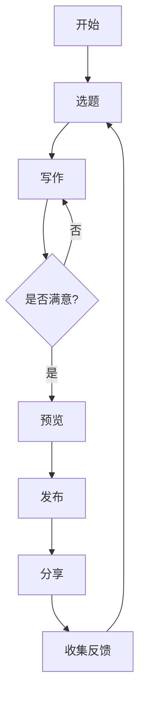

> **本文用途**：测试博客主题的标题、目录、段落、列表、表格、代码高亮、引用、图片、脚注、任务列表、数学公式、Mermaid 图表、响应式布局等渲染效果。你可以直接把这篇 Markdown 复制到博客系统中查看效果。

本文约 5000 字，阅读时间约 15 分钟。  
适合人群：准备搭建个人博客的开发者、写作者、产品经理，以及正在测试博客主题的人。

---

## 目录

- [一、为什么还要写博客？](#一为什么还要写博客)
- [二、选择适合自己的技术栈](#二选择适合自己的技术栈)
- [三、从零搭建：以 Astro 为例](#三从零搭建以-astro-为例)
- [四、写作与 Markdown 测试](#四写作与-markdown-测试)
- [五、SEO 与元数据](#五seo-与元数据)
- [六、性能与可访问性](#六性能与可访问性)
- [七、评论、统计与订阅](#七评论统计与订阅)
- [八、部署与自动化](#八部署与自动化)
- [九、备份、迁移与安全](#九备份迁移与安全)
- [十、常见问题 FAQ](#十常见问题-faq)
- [十一、30 天博客启动计划](#十一30-天博客启动计划)
- [十二、结语](#十二结语)
- [附录：Markdown 元素测试清单](#附录markdown-元素测试清单)

---

## 一、为什么还要写博客？

在短视频、社交媒体和即时通讯占据注意力的时代，写博客似乎是一件“过时”的事情。但事实恰恰相反：**博客仍然是最适合沉淀深度思考、建立个人品牌和积累长期复利的载体之一**。

### 1.1 写作即思考

很多人以为写作是“把想清楚的东西写下来”，但更真实的情况是：**写作本身就是想清楚的过程**。当你试图把一个模糊的想法解释给别人听时，你会被迫补全逻辑、寻找证据、发现漏洞。

> 如果你不能简单地解释一件事，说明你还没有真正理解它。  
> —— 费曼

### 1.2 建立个人品牌

博客是你的数字花园，也是你的在线简历。相比社交媒体的碎片化内容，博客文章更容易被搜索引擎收录，也更容易被同行引用。

### 1.3 连接同好

一篇真诚的文章可能吸引到志同道合的人。评论、邮件、RSS 订阅、友链，都是连接的方式。

### 1.4 长期复利

- 文章可以持续带来搜索流量；
- 内容可以整理成电子书、课程或演讲；
- 写作能力本身就是一项可迁移的元技能。

---

## 二、选择适合自己的技术栈

搭建博客没有“唯一正确答案”。关键是匹配你的技术背景、写作习惯和维护意愿。

| 方案      | 优点                     | 缺点                 | 适合人群             |
| --------- | ------------------------ | -------------------- | -------------------- |
| Hugo      | 构建极快，单二进制       | 模板语法需学习       | 追求速度的开发者     |
| Hexo      | 生态成熟，中文资料多     | 依赖 Node，构建偏慢  | 喜欢插件生态的人     |
| Astro     | 内容优先，组件化，性能好 | 相对新，生态仍在成长 | 前端开发者、现代博客 |
| Next.js   | 功能强大，可全栈         | 配置复杂，偏重       | React 开发者         |
| Jekyll    | GitHub Pages 原生支持    | Ruby 环境，构建慢    | 经典静态博客用户     |
| WordPress | 插件丰富，后台友好       | 需要维护、安全更新   | 非技术用户、传统站长 |
| 笔记平台  | 零配置，上手快           | 定制性弱，迁移难     | 只想快速写作的人     |

### 2.1 静态站点 vs 动态站点

- **静态站点**：预先生成 HTML，部署简单，速度快，安全性高。
- **动态站点**：服务端渲染，功能灵活，但需要数据库和服务器维护。

对大多数个人博客来说，**静态站点 + Markdown + Git** 是性价比最高的组合。

### 2.2 推荐组合

```text
写作：Markdown / MDX
生成：Astro / Hugo / Hexo
托管：Vercel / Netlify / Cloudflare Pages / GitHub Pages
评论：Giscus / Utterances
统计：Umami / Plausible
图床：Cloudflare R2 / 阿里云 OSS / GitHub + CDN
```

---

## 三、从零搭建：以 Astro 为例

下面以 Astro 为例，演示一个现代博客的基本搭建流程。

### 3.1 初始化项目

```bash
# 使用 npm 创建 Astro 项目
npm create astro@latest my-blog

# 进入目录
cd my-blog

# 安装依赖
npm install

# 启动开发服务器
npm run dev
```

### 3.2 目录结构

```text
my-blog/
├── public/
│   ├── favicon.svg
│   └── robots.txt
├── src/
│   ├── components/
│   │   ├── Header.astro
│   │   ├── Footer.astro
│   │   └── PostCard.astro
│   ├── content/
│   │   ├── config.ts
│   │   └── posts/
│   │       ├── hello-world.md
│   │       └── blog-test.md
│   ├── layouts/
│   │   └── BaseLayout.astro
│   └── pages/
│       ├── index.astro
│       └── posts/
│           └── [slug].astro
├── astro.config.mjs
├── package.json
└── tsconfig.json
```

### 3.3 基础配置

```js
// astro.config.mjs
import { defineConfig } from 'astro/config';

export default defineConfig({
  site: 'https://example.com',
  markdown: {
    shikiConfig: {
      theme: 'dracula',
      wrap: true,
    },
  },
});
```

### 3.4 内容集合配置

```ts
// src/content/config.ts
import { defineCollection, z } from 'astro:content';

const posts = defineCollection({
  type: 'content',
  schema: z.object({
    title: z.string(),
    description: z.string(),
    date: z.date(),
    tags: z.array(z.string()).default([]),
    cover: z.string().optional(),
    draft: z.boolean().default(false),
  }),
});

export const collections = { posts };
```

### 3.5 一个简单的文章页面

```astro
---
// src/pages/posts/[slug].astro
import { getCollection } from 'astro:content';
import BaseLayout from '../../layouts/BaseLayout.astro';

export async function getStaticPaths() {
  const posts = await getCollection('posts');
  return posts.map((post) => ({
    params: { slug: post.slug },
    props: { post },
  }));
}

const { post } = Astro.props;
const { Content } = await post.render();
---

<BaseLayout title={post.data.title}>
  <article>
    <h1>{post.data.title}</h1>
    <time>{post.data.date.toLocaleDateString('zh-CN')}</time>
    <Content />
  </article>
</BaseLayout>
```

---

## 四、写作与 Markdown 测试

这一节集中测试常见的 Markdown 元素。

### 4.1 文本样式

普通段落。**粗体文本**、*斜体文本*、***粗斜体***、~~删除线~~、`行内代码`、==高亮文本==、H~2~O、X^2^、Emoji :smile: :rocket: :sparkles:。

<!-- 这是一段 HTML 注释，用于测试评论渲染。 -->

### 4.2 链接与图片

[Astro 官网](https://astro.build)  
[Markdown 指南](https://www.markdownguide.org/)  
[GitHub](https://github.com/)


*图：随机图片，用于测试图片样式、圆角、阴影和响应式缩放。*

### 4.3 无序列表

- 苹果
- 香蕉
- 橙子
  - 血橙
  - 脐橙
- 葡萄

### 4.4 有序列表

1. 打开编辑器
2. 新建 Markdown 文件
3. 写下标题
4. 保存并预览
5. 发布到博客

### 4.5 任务列表

- [x] 完成初稿
- [x] 添加代码示例
- [ ] 添加图片
- [ ] 校对错别字
- [ ] 提交到 Git 仓库

### 4.6 引用

> 博客不是日记，而是你向世界发出的信号。
>
> 它不需要每天更新，但需要每一次更新都值得阅读。

### 4.7 代码块

```python
# 计算斐波那契数列
def fib(n: int) -> int:
    a, b = 0, 1
    for _ in range(n):
        a, b = b, a + b
    return a

if __name__ == "__main__":
    print([fib(i) for i in range(10)])
```

```javascript
// 防抖函数
function debounce(fn, delay = 300) {
  let timer = null;
  return function (...args) {
    clearTimeout(timer);
    timer = setTimeout(() => {
      fn.apply(this, args);
    }, delay);
  };
}

window.addEventListener('resize', debounce(() => {
  console.log('窗口大小变化');
}, 500));
```

```css
/* 响应式卡片 */
.card {
  padding: 1.5rem;
  border-radius: 1rem;
  background: #ffffff;
  box-shadow: 0 10px 30px rgba(0, 0, 0, 0.08);
}

@media (max-width: 640px) {
  .card {
    padding: 1rem;
  }
}
```

```html
<!DOCTYPE html>
<html lang="zh-CN">
<head>
  <meta charset="UTF-8" />
  <meta name="viewport" content="width=device-width, initial-scale=1.0" />
  <title>博客测试页面</title>
</head>
<body>
  <h1>Hello, Blog!</h1>
</body>
</html>
```

### 4.8 表格

| 语法          | 效果                        | 备注     |
| ------------- | --------------------------- | -------- |
| `**粗体**`    | **粗体**                    | 常用     |
| `*斜体*`      | *斜体*                      | 常用     |
| `~~删除~~`    | ~~删除~~                    | 扩展语法 |
| `` `代码` ``  | `代码`                      | 行内代码 |
| `[链接](url)` | [链接](https://example.com) | 超链接   |
| `` | 图片                        | 图片语法 |

### 4.9 分隔线

---

### 4.10 脚注

这是一个带有脚注的句子[^1]。这里是另一个脚注[^2]。

[^1]: 脚注内容：用于测试脚注跳转和返回。
[^2]: 脚注内容：博客主题是否支持脚注渲染。

### 4.11 数学公式

行内公式：$E = mc^2$。

块级公式：

$$
\int_{-\infty}^{\infty} e^{-x^2} \, dx = \sqrt{\pi}
$$

矩阵：

$$
\begin{aligned}
\begin{bmatrix}
a & b \\
c & d
\end{bmatrix}
\begin{bmatrix}
x \\
y
\end{bmatrix}
&=
\begin{bmatrix}
ax + by \\
cx + dy
\end{bmatrix}
\end{aligned}
$$

### 4.12 Mermaid 图表



### 4.13 HTML 细节

<details>
<summary>点击展开更多内容</summary>

这里是折叠区域。可以放一些不常用的说明、长代码或附录。

- 支持 HTML 的博客可以直接渲染。
- 不支持 HTML 的博客会显示为纯文本或忽略标签。

</details>

键盘按键：<kbd>Ctrl</kbd> + <kbd>C</kbd>，<kbd>Cmd</kbd> + <kbd>Enter</kbd>。

### 4.14 定义列表（部分 Markdown 扩展支持）

术语
: 定义内容，用于测试定义列表渲染。

博客
: 一种以文章形式持续更新的网站。

---

## 五、SEO 与元数据

SEO 不是玄学，而是让搜索引擎和社交平台更好地理解你的内容。

### 5.1 基础元数据

```html
<meta charset="UTF-8" />
<meta name="viewport" content="width=device-width, initial-scale=1.0" />
<title>博客测试文章：从零搭建现代个人博客的完整指南</title>
<meta name="description" content="这是一篇用于测试博客排版的长文，涵盖 Markdown、代码高亮、SEO、性能优化等内容。" />
<link rel="canonical" href="https://example.com/posts/blog-test/" />
```

### 5.2 Open Graph 与 Twitter Card

```html
<meta property="og:type" content="article" />
<meta property="og:title" content="博客测试文章" />
<meta property="og:description" content="用于测试博客排版的完整长文。" />
<meta property="og:image" content="https://example.com/cover.jpg" />
<meta property="og:url" content="https://example.com/posts/blog-test/" />

<meta name="twitter:card" content="summary_large_image" />
<meta name="twitter:title" content="博客测试文章" />
<meta name="twitter:description" content="用于测试博客排版的完整长文。" />
<meta name="twitter:image" content="https://example.com/cover.jpg" />
```

### 5.3 站点地图与 RSS

- `sitemap.xml`：告诉搜索引擎有哪些页面；
- `rss.xml`：让读者订阅更新；
- `robots.txt`：控制爬虫抓取；
- `canonical`：避免重复内容问题。

### 5.4 SEO 检查清单

| 项目       | 是否完成 | 说明                |
| ---------- | -------- | ------------------- |
| 标题唯一   | ✅        | 每篇文章标题不同    |
| 描述简洁   | ✅        | 150 字以内          |
| URL 简洁   | ✅        | 使用英文或拼音 slug |
| 图片 alt   | ✅        | 描述图片内容        |
| 内链外链   | ✅        | 增加内容关联        |
| 移动端友好 | ✅        | 响应式布局          |
| 页面速度   | ✅        | 压缩图片、CDN       |
| 结构化数据 | ⬜        | 可选 JSON-LD        |

---

## 六、性能与可访问性

性能影响用户体验和搜索排名。可访问性让更多人能够使用你的博客。

### 6.1 图片优化

```html

```

### 6.2 CSS 变量与暗色模式

```css
:root {
  --color-bg: #ffffff;
  --color-text: #1f2937;
  --color-primary: #2563eb;
}

@media (prefers-color-scheme: dark) {
  :root {
    --color-bg: #0f172a;
    --color-text: #e2e8f0;
    --color-primary: #60a5fa;
  }
}

body {
  background: var(--color-bg);
  color: var(--color-text);
}
```

### 6.3 减少动画

```css
@media (prefers-reduced-motion: reduce) {
  * {
    animation-duration: 0.01ms !important;
    animation-iteration-count: 1 !important;
    transition-duration: 0.01ms !important;
  }
}
```

### 6.4 可访问性清单

- [x] 语义化 HTML：`header`、`nav`、`main`、`article`、`footer`
- [x] 图片有 `alt`
- [x] 链接文字可读，避免“点击这里”
- [x] 颜色对比度足够
- [x] 键盘可导航
- [x] 表单有 `label`
- [ ] 添加 ARIA 标签（按需）
- [ ] 使用屏幕阅读器测试

---

## 七、评论、统计与订阅

### 7.1 评论系统对比

| 系统       | 优点                            | 缺点             | 推荐场景   |
| ---------- | ------------------------------- | ---------------- | ---------- |
| Giscus     | 基于 GitHub Discussions，无广告 | 需要 GitHub 账号 | 技术博客   |
| Utterances | 轻量，基于 GitHub Issues        | 功能较简单       | 轻量博客   |
| Disqus     | 功能全，用户多                  | 广告、隐私、速度 | 传统博客   |
| 自建       | 完全可控                        | 维护成本高       | 有后端能力 |

### 7.2 统计工具

- **Umami**：开源、轻量、隐私友好；
- **Plausible**：简洁、合规；
- **Google Analytics**：功能强，但复杂且涉及隐私；
- **Fathom**：付费，注重隐私。

### 7.3 RSS 与 Newsletter

RSS 是博客的“开放订阅协议”。即使平台更迭，RSS 依然可靠。

```xml
<rss version="2.0">
  <channel>
    <title>我的博客</title>
    <link>https://example.com</link>
    <description>记录思考与实践</description>
    <item>
      <title>博客测试文章</title>
      <link>https://example.com/posts/blog-test/</link>
      <description>用于测试博客排版的完整长文。</description>
    </item>
  </channel>
</rss>
```

---

## 八、部署与自动化

### 8.1 常见托管平台

| 平台             | 免费额度 | 自定义域名 | 特点               |
| ---------------- | -------- | ---------- | ------------------ |
| Vercel           | 有       | 支持       | 前端部署体验好     |
| Netlify          | 有       | 支持       | 表单、函数、重定向 |
| Cloudflare Pages | 有       | 支持       | 全球 CDN，速度快   |
| GitHub Pages     | 有       | 支持       | 简单，适合静态站点 |

### 8.2 GitHub Actions 自动部署

```yaml
name: Deploy Blog

on:
  push:
    branches: [main]

jobs:
  build:
    runs-on: ubuntu-latest
    steps:
      - uses: actions/checkout@v4

      - uses: actions/setup-node@v4
        with:
          node-version: 20
          cache: npm

      - run: npm ci
      - run: npm run build

      - uses: peaceiris/actions-gh-pages@v3
        with:
          github_token: ${{ secrets.GITHUB_TOKEN }}
          publish_dir: ./dist
```

### 8.3 部署检查清单

- [x] 构建成功
- [x] 域名解析正确
- [x] HTTPS 启用
- [x] 重定向配置
- [x] 404 页面
- [x] RSS 可访问
- [x] sitemap 可访问
- [ ] 提交搜索引擎

---

## 九、备份、迁移与安全

### 9.1 备份策略

- 文章源码放在 Git 仓库；
- 图片使用对象存储或图床，并保留本地副本；
- 数据库定期导出；
- 重要内容多平台备份。

### 9.2 迁移检查清单

| 项目 | 说明                |
| ---- | ------------------- |
| 域名 | 是否需要转移        |
| DNS  | 修改解析记录        |
| 内容 | 导出 Markdown / XML |
| 图片 | 下载并替换链接      |
| 评论 | 导出或关闭          |
| 统计 | 更新跟踪代码        |
| SEO  | 设置 301 重定向     |

### 9.3 安全建议

- 及时更新依赖；
- 不使用弱密码；
- 开启双因素认证；
- 静态站点也要注意供应链安全；
- 动态站点需防 SQL 注入、XSS、CSRF。

---

## 十、常见问题 FAQ

### Q1：博客需要每天更新吗？

不需要。质量比频率重要。稳定更新比频繁断更更好。

### Q2：没有流量还要写吗？

要。写作首先是为了自己。流量是结果，不是前提。

### Q3：用 WordPress 还是静态博客？

如果你不懂代码且需要复杂插件，选 WordPress。如果你愿意用 Markdown 和 Git，选静态博客。

### Q4：文章应该写多长？

看主题。教程可以长，观点可以短。不要为了长而长。

### Q5：如何避免半途而废？

- 降低发布门槛；
- 建立选题库；
- 公开承诺；
- 找到写作伙伴；
- 把博客当成长期项目，而不是短期任务。

---

## 十一、30 天博客启动计划

| 天数        | 任务               | 状态 |
| ----------- | ------------------ | ---- |
| 第 1 天     | 确定博客主题和定位 | ✅    |
| 第 2 天     | 选择技术栈         | ✅    |
| 第 3 天     | 注册域名           | ⬜    |
| 第 4 天     | 初始化项目         | ⬜    |
| 第 5 天     | 配置主题           | ⬜    |
| 第 6 天     | 写关于页面         | ⬜    |
| 第 7 天     | 发布第一篇文章     | ⬜    |
| 第 8-14 天  | 完善 SEO 和 RSS    | ⬜    |
| 第 15-21 天 | 写 3 篇文章        | ⬜    |
| 第 22-28 天 | 添加评论和统计     | ⬜    |
| 第 29 天    | 性能优化           | ⬜    |
| 第 30 天    | 正式分享           | ⬜    |

---

## 十二、结语

搭建博客不是终点，持续写作才是。  
技术栈会变化，平台会兴衰，但**清晰表达、长期积累、真诚分享**永远不会过时。

如果你正在测试博客主题，希望这篇文章能帮你检查：

- 标题层级是否清晰；
- 目录是否可跳转；
- 代码高亮是否正常；
- 表格是否响应式；
- 图片是否自适应；
- 脚注是否能返回；
- 数学公式是否渲染；
- Mermaid 是否支持；
- 暗色模式是否舒适；
- 移动端阅读是否友好。

> 最好的博客，不是最漂亮的，而是你愿意一直写下去的。

---

## 附录：Markdown 元素测试清单

- [x] 一级标题
- [x] 二级标题
- [x] 三级标题
- [x] 段落
- [x] 粗体
- [x] 斜体
- [x] 删除线
- [x] 行内代码
- [x] 代码块
- [x] 引用
- [x] 无序列表
- [x] 有序列表
- [x] 嵌套列表
- [x] 任务列表
- [x] 表格
- [x] 链接
- [x] 图片
- [x] 分隔线
- [x] 脚注
- [x] 数学公式
- [x] Mermaid
- [x] HTML 折叠
- [x] 键盘按键
- [x] Emoji
- [x] 高亮
- [x] 上下标

---

*版权声明：本文为博客测试文章，可自由修改用于个人博客主题测试。*